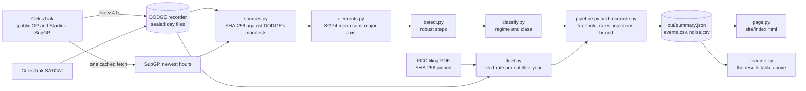
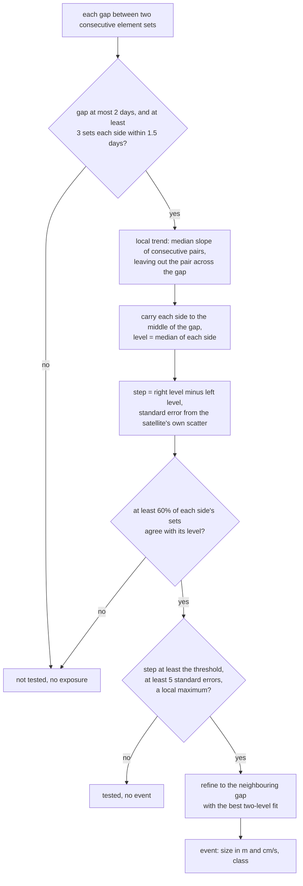
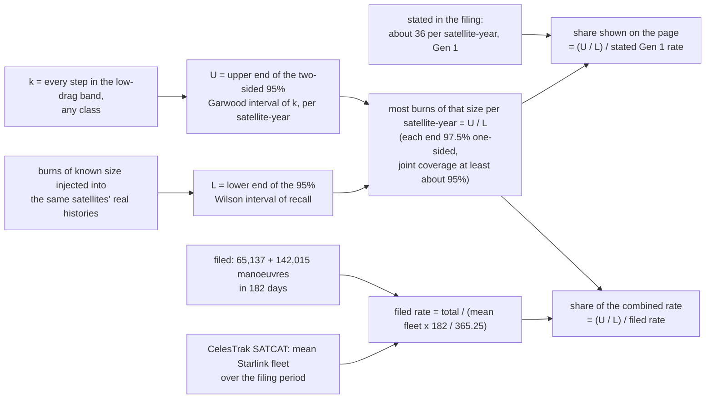

# Maneuver Ledger

**How many of Starlink's collision-avoidance burns can public orbit data see?**

[](https://github.com/GautamTalksDev/maneuver-ledger/actions/workflows/ci.yml)
[](LICENSE)
[](LICENSE-DATA)

**Result in one line:** public element sets cannot rebuild the 207,152 avoidance manoeuvres SpaceX filed with the FCC;
in the cleanest test, burns of 16 cm/s or more are at most 2.8 per satellite-year, 8% of the lower filed rate.

Results page: [dodge.gautamkhosla.com/ledger/](https://dodge.gautamkhosla.com/ledger/) (the same numbers as `site/index.html`).

```
AMBITION PASS (17 Oct 2026)
Literal ask:  "Reconstruct Starlink's collision-avoidance manoeuvres from public orbit data, and reconcile the total
              against SpaceX's own FCC report."
Outcome:      a SpaceX or Starlink engineer checks it in a minute and replies -> metric: one engineer or recruiter
              reply by Sun 31 Jan 2027 (source: Gautam's inbox, once he publishes the repo).
              Pre-registered: GREEN if GP and SupGP agree on at least 70% of steps above the limit beyond chance and
              the rate interval meets the filed rate; YELLOW ships the detection-limit result. A miss is a result.
Depth:        1 reconcile like for like: avoidance only, rates not counts, with a detection-limit curve instead of a
                count | 2 rawest material: DODGE's sealed day files (every 4 h since 6 Oct), today's CelesTrak SupGP,
                the FCC PDF itself (SHA-256 pinned) | 3 methods: SGP4 mean elements, robust step detection,
                Gauss's equation for delta-v, false alarms calibrated on passive debris, injection-recovery on real
                histories, time-slide background | 4 outside judges: synthetic burns of known size, passive debris,
                catalogue launch dates, the FCC's own named list, SupGP, and the filed rate itself.
Crew (verbs): measure the noise floor -> orbit analyst: out/noise.csv | detect the burns -> ledger/detect.py |
              put error bars on it -> statistician: bootstrap, Poisson, Wilson in out/summary.json | check every
              word against the filing -> fact checker: ledger/fleet.py quotes + PDF hash | try to make it look like
              hype -> red team: limits first, "not reproduced" on the page | shrink it -> editor: one-minute box.
Goal:         MVP today on DODGE's 12 days, every number traced; prior example: DODGE shipped on CelesTrak data in
              one night (6 Oct 2026); permission to fail: if public data cannot see the burns, the detection limit
              IS the finding. (It is: see below.)
```

## The result

<!-- results:start (generated by ledger/readme.py from out/summary.json; do not edit) -->

| | |
|---|---|
| Filed by SpaceX (FCC, 2025-12-01 to 2026-05-31) | 207,152 avoidance manoeuvres (65,137 Gen 1 + 142,015 Gen 2) |
| Per satellite per year | 42.1 (fleet of 9,866 from CelesTrak SATCAT); stated: about 36 Gen 1, about 46 Gen 2 |
| Public data used | 2026-10-03 to 2026-10-17, 9,479 on-station satellites, 112.8 satellite-years tested |
| Detection threshold | 175 m of semi-major axis: about 9.7 cm/s at 470 km, 9.5 cm/s in the low-drag band; false alarms on passive debris 0.58 per object-year (95% upper 2.09) |
| Steps above it, 400 to 600 km | drag make-up 25.2 per sat-year; avoidance-like 8.7 (8.2 to 9.3) |
| Low-drag band 530 to 600 km | 6 steps of any kind in 4.8 satellite-years: at most 2.71 per sat-year (conservative 95% bound, see docs/METHODS.md section 7) |
| Recall in that band | 98% at 16 cm/s, 65% at 10 cm/s (burns injected into real histories) |
| Burns of 16 cm/s or more | at most 2.8 per sat-year, 8% of the lower filed rate |
| Synthetic exam at 16 cm/s | precision 100.0%, recall 99.7% |
| Held out: launched during the window | 27 of 27 labelled raising; launched over a year before: 37 raising of 8,036 |
| GP against SupGP, beyond chance | 29% (pre-registered line 70%: not met) |

**Headline:** if the filing-period rate still held, at least 92% of Starlink avoidance manoeuvres are smaller than 16 cm/s along track (or leave the orbit's size unchanged), so public element sets cannot rebuild the 207,152. **The 207,152 was not reproduced.**

<!-- results:end -->

Against the pre-registered lines: **GREEN was not met** (GP and SupGP agree far less than 70% beyond chance, and the
rate of visible avoidance-like steps is well below the filed rate). **YELLOW shipped**: the detection limit, measured
three independent ways, is the result. The pipeline is built to tighten the bound every day as DODGE keeps recording.

## Check it in a minute

1. Open `site/index.html` (one file, no scripts). The box at the top has the three numbers.
2. The filed rate: `ledger/fleet.py` quotes the FCC sentence word for word, with the PDF's URL and SHA-256.
   65,137 + 142,015 = 207,152 over 182 days; the average fleet comes from CelesTrak's SATCAT launch and decay dates.
3. The bound: `out/summary.json` -> `bound`. The count of steps in the low-drag band, the upper end of its two-sided
   95% Poisson interval, divided by the lower end of the recall measured by injecting burns into those same
   satellites' real histories (`bound.rows[].max_rate`). `max_share_of_gen1` is that rate over the Gen 1 filed rate
   (the share the page shows); `max_share_of_combined` is the same over the combined rate.
4. Any single step: `out/events.csv` (time window, size in metres and cm/s, local trend, class, what SupGP saw).

## How it works



A burn that is short compared with the spacing between element sets changes the orbit's mean semi-major axis `a`
in one step: `da = 2 a dv / v` for an along-track burn (Gauss). Drag changes it slowly. So the detector looks for
steps in each satellite's history of `a`, measured with SGP4's own mean elements (which remove the 10 km swings that
Earth's oblateness puts on the osculating `a` every orbit).



The reconciliation compares rates, never counts, because the filing covers December 2025 to May 2026 and the data
covers October 2026:



Every assumption and every limit: [docs/METHODS.md](docs/METHODS.md). Components and data flow:
[docs/ARCHITECTURE.md](docs/ARCHITECTURE.md). Sources and their terms: [docs/DATA.md](docs/DATA.md). Common
questions, including why public data cannot see small burns: [docs/FAQ.md](docs/FAQ.md).

## Quickstart

Linux or WSL (Ubuntu 24.04), Python 3.12, no accounts or keys:

```bash
git clone https://github.com/GautamTalksDev/maneuver-ledger.git && cd maneuver-ledger
python3 -m venv .venv && .venv/bin/pip install --require-hashes --no-deps -r requirements.txt
.venv/bin/python -m unittest discover -s tests -p "test_*.py"   # runs without any downloaded data
.venv/bin/python -m ledger.pipeline sync   # new DODGE day files + at most one CelesTrak SupGP download
.venv/bin/python -m ledger.pipeline all    # about 3 minutes on one core; writes out/, site/, README results
```

`sync` is the only step that touches the network. It reads DODGE's public GitHub releases (no login) and fetches
CelesTrak's Starlink SupGP file at most once per 2 hours, as CelesTrak's usage policy asks; a 403 ("not updated") is
never retried. Everything after it is offline and seeded. A `sync` today gives you more days than the committed
results used, so your numbers will be newer, not identical. To get the committed numbers exactly, use the next
section.

## Reproduce the committed results byte for byte

The committed outputs used DODGE's sealed days 6 to 16 October, DODGE's files for 17 October as downloaded before
DODGE sealed that day, and one CelesTrak SupGP download (17 October 2026, 19:04 UTC). The last two no longer exist upstream, so they are
attached, unchanged, to the release
[`inputs-2026-10-17`](https://github.com/GautamTalksDev/maneuver-ledger/releases/tag/inputs-2026-10-17), and every
input file's SHA-256 is in [`data/inputs-2026-10-17.sha256`](data/inputs-2026-10-17.sha256).

```bash
tools/reproduce.sh     # downloads the inputs, checks every SHA-256, runs the pipeline, lists changed outputs
```

It needs `curl` and `sha256sum` and no login. It ends with `git status`: no changed files means every output is
byte-identical to the commit. One part depends on code outside this repository: the `dodge_baseline` block (DODGE's
first manoeuvre stub, kept for comparison) runs DODGE's `engine/maneuvers.py`, found through `DODGE_DIR`. The
committed numbers used a version not yet on DODGE's main branch. With DODGE main, two numbers in that block of
`out/summary.json` change and nothing else (checked 17 October 2026); without DODGE, the block and its one row on the
page drop out. Details: [docs/DATA.md](docs/DATA.md#reproducing).

## Limits, stated first

- **Different months.** Filing: December 2025 to May 2026. Data: October 2026. Rates are compared, never counts.
- **Only the size of the orbit is measured.** Burns that change only the plane or shape, and pairs of burns that
  cancel inside one gap between element sets, are invisible.
- **Short window.** About two weeks; the low-drag band has a few hundred satellites. The bound tightens as DODGE
  records.
- **Classes are heuristics.** The bound counts every step in the band, whatever its class.
- **Gen 1 and Gen 2 are not separated**, so the comparison uses the lower filed rate.
- **Screening grade.** Not for operations. Not affiliated with SpaceX or Starlink.

All of them, with the reasoning: [docs/METHODS.md, section 9](docs/METHODS.md#9-limits).

## Why a separate repository, and what it reuses

[DODGE](https://github.com/GautamTalksDev/dodge) already records the history and seals it. This project **reads
DODGE's sealed releases and never records anything itself**, so there is one recorder and one source of truth. It
also runs DODGE's first manoeuvre stub (`engine/maneuvers.py`) on the same data as a baseline and shows why it is
replaced. It lives in its own repository because DODGE has a strict release and sealing workflow that this research
code should not touch. The results page is published under DODGE's site at
[/ledger/](https://dodge.gautamkhosla.com/ledger/).

## Layout

| Path | What |
|---|---|
| `ledger/` | the pipeline, one module per step, each with a docstring explaining the physics or the rule |
| `tests/` | unit tests: physics, synthetic burns of known size, sources, statistics, page, README and docs rules |
| `out/summary.json` | every number the page and this README show |
| `out/events.csv` | every detected step, GP and SupGP |
| `out/noise.csv` | per satellite: sets, span, altitude, regime, local noise |
| `site/index.html` | the results page; `site/index.numbers.json` lists every number it prints and its source |
| `data/fcc_2026-07-01_lists.json` | the satellites the FCC report names as removed for disposal, parsed by `tools/parse_fcc.py` |
| `data/inputs-2026-10-17.sha256` | SHA-256 of every input file behind the committed results |
| `tools/reproduce.sh` | byte-for-byte reproduction of the committed results |
| `docs/` | [METHODS](docs/METHODS.md), [ARCHITECTURE](docs/ARCHITECTURE.md), [DATA](docs/DATA.md), [FAQ](docs/FAQ.md) |
| `cache/` | downloaded inputs (not committed) |

## Rules this repository keeps

- Data: CelesTrak public GP and SupGP sets, as recorded by DODGE, and the CelesTrak catalogue. No Space-Track data
  (its user agreement restricts redistributing its data, so it is not used). SpaceX's raw ephemeris files on
  api.starlink.com are not used in this version (see [docs/DATA.md](docs/DATA.md)).
- Every number on the page comes from `out/summary.json` (enforced by `tests/test_page.py`). No em or en dashes
  anywhere (enforced by `tests/test_repo_text.py`).
- Screening grade. Not for operations. Not affiliated with SpaceX or Starlink.

## Security

No secrets, accounts or servers. CI runs the tests with a read-only token, every third-party action pinned to a full
commit SHA, and dependencies installed with `--require-hashes`. The results page has no scripts and a strict Content
Security Policy. Report vulnerabilities privately: [SECURITY.md](SECURITY.md).

## Cite

See [CITATION.cff](CITATION.cff), or use "Cite this repository" on GitHub:

> Khosla, G. (2026). *Maneuver Ledger: Starlink collision-avoidance burns against public orbit data* (version 0.1.0).
> https://github.com/GautamTalksDev/maneuver-ledger

## Licence

- **Code:** Apache-2.0 ([LICENSE](LICENSE)).
- **Derived data this repository produces** (`out/`, the numbers on the page): CC BY 4.0
  ([LICENSE-DATA](LICENSE-DATA)). Credit "Maneuver Ledger (github.com/GautamTalksDev/maneuver-ledger), Gautam Khosla".
- **Input data keeps its own terms:** orbit data from [CelesTrak](https://celestrak.org) (Dr T.S. Kelso), recorded
  by [DODGE](https://github.com/GautamTalksDev/dodge), under CelesTrak's usage policy; the
  [FCC filing](https://api-prod.fcc.gov/icfs-attachment/exp/api/v1/bff0244acfb947505791bf252f851ce6) is SpaceX's.
  See [docs/DATA.md](docs/DATA.md).

Independent work from public data. Not affiliated with SpaceX or Starlink.
