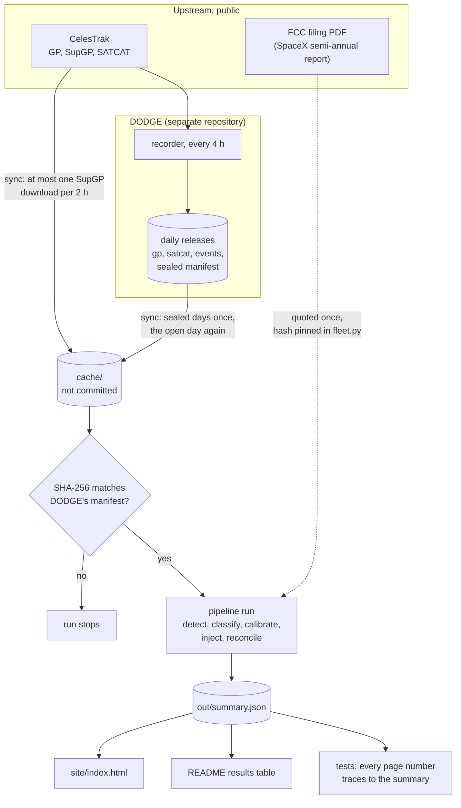
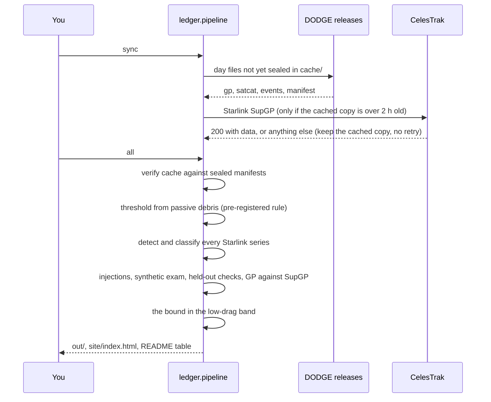

# Architecture

Maneuver Ledger is a batch pipeline: public orbit recordings in, one JSON summary out, and a static page and a
README table generated from that summary. There is no server, database, account or secret. The only network access
is `python -m ledger.pipeline sync`; every later step is offline and seeded.

## Components

| Component | File | Input | Output |
|---|---|---|---|
| Sources | `ledger/sources.py` | DODGE's release assets (`gp-`, `satcat-`, `events-`, `manifest-` per UTC day), one CelesTrak SupGP download | files in `cache/`, checked against DODGE's sealed SHA-256 manifests |
| Elements | `ledger/elements.py` | one OMM element set | SGP4 mean semi-major axis and argument of latitude at the set's own epoch; Gauss's `dv = v da / (2a)` |
| Detector | `ledger/detect.py` | one satellite's time series of mean semi-major axis | candidate steps per gap, with standard error, consensus and refined location |
| Classifier | `ledger/classify.py` | a series and its steps | regime (raising, descending, on-station) and class (drag make-up, avoidance-like, large on-station) |
| Fleet | `ledger/fleet.py` | the FCC filing (quoted, SHA-256 pinned), CelesTrak SATCAT | the filed rate per satellite-year, implied fleets |
| Statistics | `ledger/reconcile.py` | counts and exposures | rates, bootstrap, Garwood and Wilson intervals |
| Synthetic | `ledger/synth.py` | noise and bad-set share measured on real data | synthetic histories with burns of known size; injection into real histories |
| Pipeline | `ledger/pipeline.py` | all of the above | `out/summary.json`, `out/events.csv`, `out/noise.csv` |
| Page | `ledger/page.py` | `out/summary.json` | `site/index.html` and `site/index.numbers.json` (every printed number and its source path) |
| README table | `ledger/readme.py` | `out/summary.json` | the block between the `results:start` and `results:end` markers in `README.md` |

## Data flow



## One run, in order



## Determinism

- Fixed seed (`SEED = 2026` in `ledger/pipeline.py`) for bootstrap, injections and synthetic histories.
- Inputs are read in sorted order and de-duplicated on (kind, satellite, epoch).
- `out/summary.json` is written with sorted keys. Two runs on the same `cache/` give byte-identical outputs; the
  release gate checked this on a clean clone, and `tools/reproduce.sh` lets anyone check it.

## Trust boundaries

| Boundary | What could go wrong | Control |
|---|---|---|
| DODGE's releases | a day file changed after sealing | SHA-256 against DODGE's sealed manifest; a mismatch stops the run |
| CelesTrak | overuse, or an error page parsed as data | at most one download per 2 hours, body must be a JSON array, non-200 is never retried |
| Downloaded bodies | very large or malformed files | body size capped (256 MB), rows without an epoch, mean motion or catalogue number are dropped |
| The FCC number | a misquote | the sentence is quoted word for word in `ledger/fleet.py` with the PDF's URL and SHA-256 |
| The page | script injection, third-party requests | no scripts, no external resources, every string HTML-escaped, a Content Security Policy that allows only the page's own styles |
| CI | a compromised action or token misuse | read-only token, actions pinned to full commit SHAs, no secrets, hash-pinned dependencies |

## Where things live

```
ledger/        the pipeline (one module per step)
tests/         unit tests, including text rules (no em or en dashes, withdrawn claims stay out)
out/           the committed results
site/          the generated page
data/          the FCC lists and the SHA-256 of every input behind the committed results
docs/          METHODS, ARCHITECTURE, DATA, FAQ
tools/         parse_fcc.py (one-off PDF parse), reproduce.sh
cache/         downloads (not committed)
```

The same page is published under DODGE's site at `/ledger/`, restyled to DODGE's design system and served with
DODGE's stricter headers; its numbers are generated from the same `out/summary.json`.
